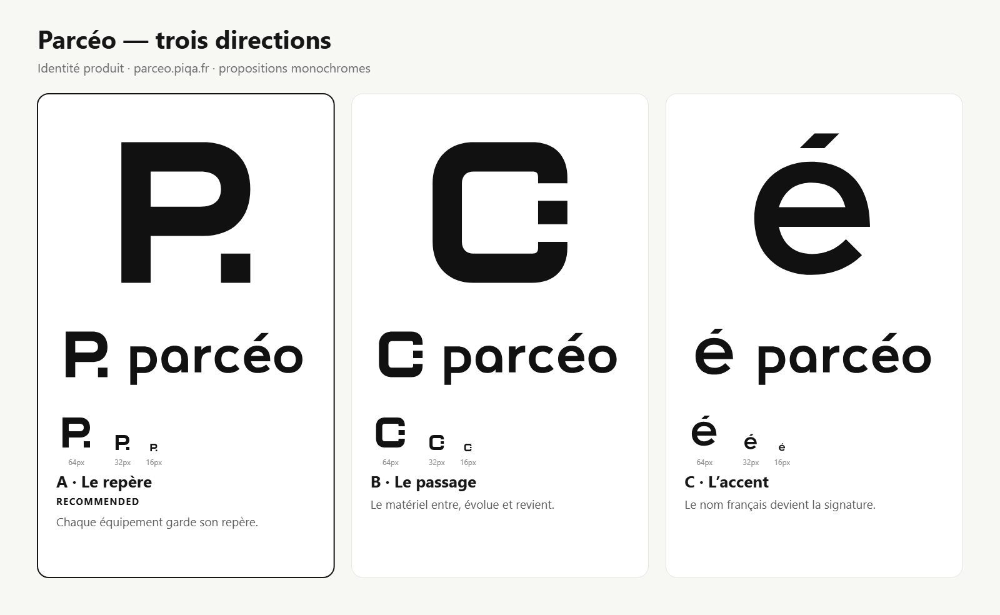

# Parcéo — trois directions à choisir

La planche présente trois explorations, pas une identité finale approuvée. Proposition de promesse : **Votre parc, clairement.**

- **A — Le repère, recommandé :** un P et une unité détachée, pour un parc organisé et des équipements identifiés. Bon candidat pour Parcéo Collector.
- **B — Le passage :** un ensemble ouvert et un élément mobile, pour le parcours du matériel. Lecture possible comme C ; plus abstrait.
- **C — L’accent :** une signature centrée sur le nom français et son é. Lecture immédiate du caractère, association moins directe au matériel.

## Vérifications réalisées

Les SVG ont été dessinés en chemins originaux, sans reprendre les contours de la bibliothèque ni dépendre d’une police. Rendus réalisés avec Chrome local et inspectés : [planche comparative](parceo-concepts.png), [essais détaillés](preview-v2.html), [capture des essais](preview-tests.png).

Deux passages de construction et d’audit sont conservés. À la première inspection, l’accent C dépassait du canevas et les espaces de séparation A/B étaient trop serrés. La deuxième passe réduit l’unité de A à un carré de 40 unités, ouvre son écart à 24 unités, élargit les ouvertures de B à 24 unités et recentre B ; C est ramené dans le canevas avec un angle de terminaison corrigé à 45°.

Résultats du script `svg_audit.py` : A 100, B 100, C 99 ; les trois associations symbole/nom 100. Ces scores sont des heuristiques de structure, pas des mesures d’originalité ou une certification de qualité. Aucune alerte de débordement, de texte vivant, de raster ou de filtre dans la passe v2. Le seul avis restant concerne le centrage vertical de C : l’accent fait intentionnellement monter la boîte de dessin.

Inspection visuelle : silhouettes à 16/32/64 px, noir sur blanc et blanc sur noir, miroir, rotation, flou, contextes onglet/application/en-tête et comparaison avec 11 références matérielles de la bibliothèque. Les trois symboles gardent leur structure ; A offre le lien le plus direct avec le nom. Les fonds sombres de la feuille montrent qu’il faut employer la variante blanche, jamais le noir. L’accent de C est plus discret à 16 px. Les inversions sont des essais automatiques, pas encore des fichiers de production corrigés optiquement.

Pas de test avec un panel extérieur, de recherche exhaustive de ressemblances, de validation de marque ni de preuve d’impression. Aucune palette ou police d’interface n’est encore arrêtée.

## Étape suivante

Le [skill demandé](https://github.com/kaankiziltug/logo-design-skill/blob/bbf31e521d765eb6d53242549bbee7c2e5bbd6bc/skills/logo-design/SKILL.md) exige : « Build the kit (Phase 7) only after they pick a direction and say yes. »

Après choix : palette et contrastes, typographies d’interface avec licences vérifiées, variantes couleur et monochromes, compositions horizontale/verticale, favicon et icônes du collecteur, exemples pertinents pour l’application et guide d’utilisation. Aucun changement d’application, de dépôt distant ou de DNS n’a été effectué.

Le brief, la recherche et les idées écartées sont dans [brief.md](brief.md). Les scores bruts sont dans [audit-v1.json](audit-v1.json) et [audit-v2.json](audit-v2.json). Les dessins sont reproductibles avec `python design/parceo/concepts/build-concepts.py` ; les outils du skill sont conservés localement sous `reports/parceo-design-tools/logo-design` à la révision `bbf31e521d765eb6d53242549bbee7c2e5bbd6bc`.
